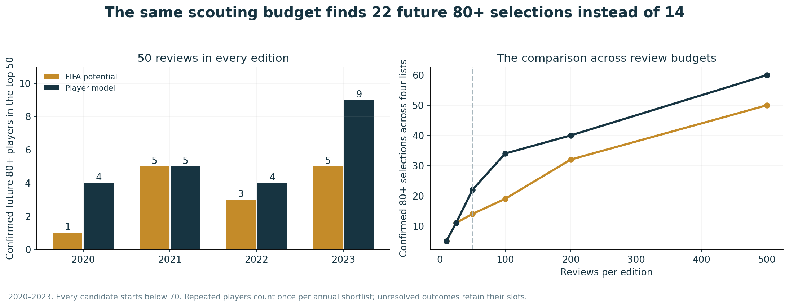

# Beyond FIFA Potential: Finding Hidden Gems

A retrospective scouting study: can a model find more future 80+ players while their current FIFA rating is below 70?

[Read the analysis](https://rafaelnikitas.github.io/studies/fifa-hidden-gems/) · [Interactive scouting replay](https://rafaelnikitas.github.io/demos/scouting.html) · [Kaggle notebook](https://www.kaggle.com/code/rafanikitas/football-s-hidden-gems-ml-vs-fifa-potential) · [Portfolio](https://rafaelnikitas.github.io)



## Main result

Across four dated 2020–2023 replays, the player model identifies **22 confirmed future 80+ selections**, compared with **14** from FIFA potential, using the same **200 review slots**. Those are 20 and 12 distinct successful players. Confirmed precision is 11% versus 7%, and confirmed recall is 21.8% versus 13.9% of 101 documented player-edition outcomes.

The model **includes FIFA potential** alongside skills, history, team strength and peer comparisons. It tests whether the extra information improves the shortlist. The conditional paired player-bootstrap interval for the +8 hit difference is +1 to +15; it holds models and historical cohorts fixed and does not cover model-selection uncertainty.

## Evaluation

- Current overall below 70, any age, excluding previously observed 85+ players.
- Outcome: reaches 80+ in the next three game editions.
- Training uses only outcome windows completed by the decision edition.
- A negative needs all three future records; incomplete careers remain unresolved.
- Feature removal, a same-learner FIFA-input control, top-K metrics and native SHAP explanations accompany the ranking comparison.
- CatBoost settings were fixed. Automated hyperparameter tuning and probability calibration were not performed. Scores are ranking indices.

This archive had been explored previously. These are retrospective replays, not an untouched prospective test. For the rarer 85+ diagnostic, both approaches find five confirmed selections.

## Latest explained shortlist

The top-20 list is based on **21 September 2025**, FC26. It is a dated prospective shortlist, not a live 2026 roster. All future outcomes remain unconfirmed. Its date, source audit and full SHAP contributions are in `results/latest_shortlist_audit.json`, `results/newer_sources_checked.json` and `results/latest_shortlist_shap.csv`.

## Run and edit

The source notebook is kept small in Git; its recorded charts, tables and article are published on the portfolio. The complete executed notebook, model bundles and normalized source snapshots are supplied in the [**v1.0.0 release bundle**](https://github.com/rafaelnikitas/fifa-hidden-gems/releases/tag/v1.0.0).

1. Import `FIFA_Beyond_Potential_Hidden_Gems.ipynb` into Kaggle and attach the three public source datasets below.
2. Run all cells on CPU. The default fits the models; the complete release bundle also contains checked dated caches.
3. Edit ordinary Markdown cells to write your own story. See [EDITING_GUIDE.md](EDITING_GUIDE.md).

For a local run, install `requirements.txt` and use the normalized snapshots from the complete release bundle. Run `python execute_notebook.py`. The HTML exporter reads saved notebook outputs without fitting models again.

## Sources and attribution

1. [Stefano Leone: FIFA15–FC24 men's snapshots](https://www.kaggle.com/datasets/stefanoleone992/ea-sports-fc-24-complete-player-dataset), CC0.
2. [Davis Nyagami: FC25](https://www.kaggle.com/datasets/nyagami/ea-sports-fc-25-database-ratings-and-stats), Apache 2.0.
3. [rovnez: FC26 September 2025](https://www.kaggle.com/datasets/rovnez/fc-26-fifa-26-player-data), CC BY 4.0.

Exact player IDs join editions. Source attribution and applicable dataset licenses are preserved in `DATA_LICENSES/`; no source-author endorsement is implied. No additional license for the analysis code is declared here.

## Verify the published evidence

```bash
python -m pip install nbformat numpy pandas
python scripts/verify_evidence.py
```

The checks validate the notebook structure, published hit counts, candidate eligibility and all 20 SHAP score decompositions. They do not train models or establish prospective scouting accuracy.
